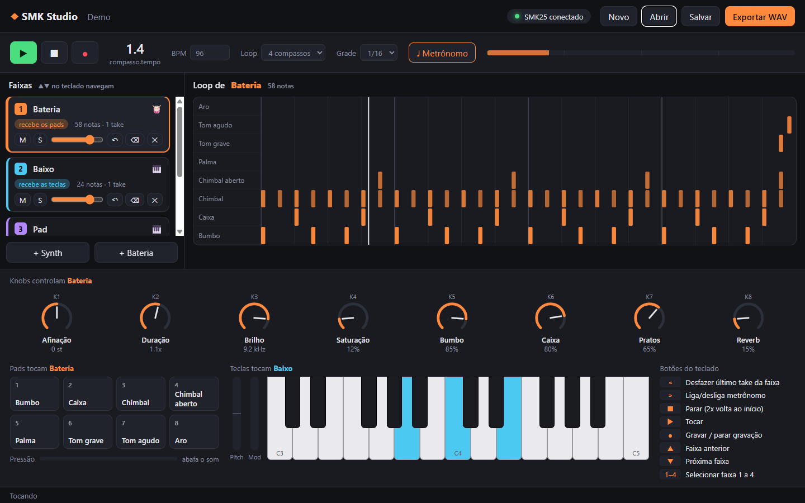
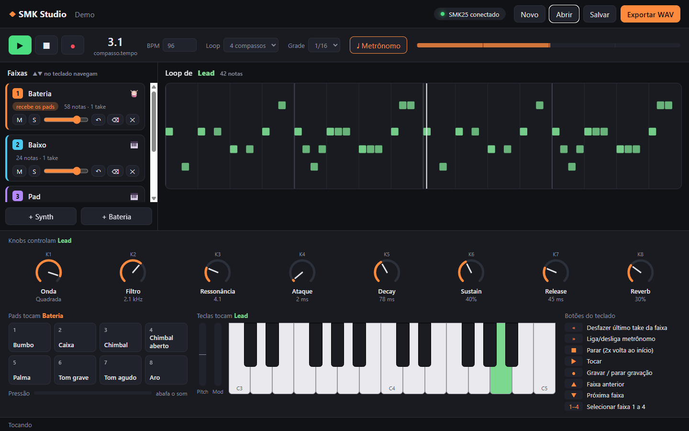

<h1 align="center">SMK Studio</h1>

<p align="center">A desktop DAW built around one specific controller, the Midiplus SMK-25 V2.<br>
Every physical knob, pad and button has a fixed job and is mirrored on screen, so there is no MIDI Learn step.</p>

<p align="center">
  
  <a href="LICENSE"></a>
  
  
</p>

<p align="center">
  
  
  
  
  
  
</p>

<p align="center">
  
  <br><em>The demo project (<code>exemplos/demo.smk.json</code>) playing. The drum track is selected, so the 8 knobs show its parameters; the highlighted keys are a chord held on the controller.</em>
</p>

## Why

General-purpose DAWs treat a small controller as a generic MIDI device: you map each knob by hand, the mapping drifts between projects, and the screen never tells you what the hardware is doing. SMK Studio goes the other way. It knows the SMK-25 V2 exactly (its ports, channels, CC numbers and even the quirks of its pads, captured from the real device) and builds a loop-based workflow where the keyboard alone is enough to record a song sketch.

The interface text is in Portuguese; this documentation is in English.

## What each control does

| Control | Function |
|---|---|
| **25 keys** | Play the active synth track |
| **Pitch / Mod** | ±2 semitone pitch bend / vibrato |
| **8 knobs** | The 8 parameters of the **selected** track (name and value shown on screen) |
| **8 pads** | Active drum kit: kick, snare, closed hi-hat, open hi-hat, clap, low tom, high tom, rim |
| **Pad pressure** | Muffles the drums while you press (channel aftertouch drives a filter) |
| **▶ / ■ / ●** | Play / stop (twice returns to the start) / record |
| **« / »** | Undo the last take on the track / toggle the metronome |
| **▲ / ▼** | Previous / next track |
| **Buttons 1–4** | Select tracks 1 to 4 |

PC keyboard: `Space` play/stop, `R` record, `Ctrl+Z` undo, `Ctrl+S` save, `Ctrl+O` open, `↑/↓` change track.

<p align="center">
  
  <br><em>With a synth track selected the knobs switch to waveform, filter, resonance, envelope and reverb, and the loop view shows the recorded notes by pitch.</em>
</p>

## Recording

1. Select a track (click it or use the controller buttons).
2. Press **●**: the loop starts playing and recording.
3. Play. Each note is quantized to the chosen grid and is heard on the next pass.
4. Press **●** again to close the take. Recording again overdubs; **«** removes the last take.

Projects are saved as validated JSON (`.smk.json`), and the loop can be exported to WAV.

## Running it

Double-click **`Iniciar SMK Studio.cmd`**, or:

```
npm install
npm run build
npm start
```

To try it without the controller, open `exemplos/demo.smk.json` (Abrir / `Ctrl+O`); the on-screen pads and keys respond to the mouse.

> Close other programs using the SMK25 over USB (DAWs, Bome MIDI Translator). On Windows a MIDI port can stay locked to the first program that opened it.

## Development

```
npm test          # unit tests (Vitest)
npm run coverage  # coverage report
npm run typecheck
npm run dev       # development mode with hot reload
```

The design, the controller profile and the timing decisions are described in [docs/ARCHITECTURE.md](docs/ARCHITECTURE.md).

## Roadmap

- Audio recording (microphone or audio interface)
- Per-track effects (delay, chorus, compressor)
- Song mode: chaining loops into an arrangement
- Live clip launching from the pads

## License

[MIT](LICENSE).
